<div align="center">


# Beatrice Dataset Studio for Windows

[简体中文 · Windows RVC 数据集工作台](README.zh-CN.md)

**Turn any voice into a clean, transcribed training dataset, on your own PC.**<br/>
Search a character or voice actor, or drop in your own recordings. The studio isolates the voice, slices it into clips, scores and transcribes them, and hands you a ZIP that's ready for the Beatrice trainer, RVC or TTS.

[](https://github.com/Project-Beatrice-V2/Beatrice-dataset-webui-windows)
[](https://project-beatrice.vercel.app)
[](https://github.com/Project-Beatrice-V2)


[Get started](#-get-started) · [Website](https://project-beatrice.vercel.app) · [Mac version](https://github.com/Project-Beatrice-V2/Beatrice-dataset-webui-macos) · [Report a bug](https://github.com/Project-Beatrice-V2/Beatrice-dataset-webui-windows/issues/new)

<br/>


</div>

---

## ✨ Why Beatrice Dataset Studio

- 🔎 **Start from a name.** Search an anime character, game character, voice actor, musician or public speaker. The studio looks up who they are, then finds audio on the Hugging Face Hub, YouTube and Bilibili.
- 🎚️ **A full cleaning pipeline.** Demucs strips music and effects, pyannote finds who is speaking, Silero VAD cuts at natural pauses, and every clip is denoised, loudness-normalised and scored 0–100.
- 🗣️ **Only the voice you asked for.** Resemblyzer checks each clip against a voiceprint of the target speaker, so other characters don't leak into your dataset.
- ✍️ **Transcribed for you.** Whisper writes a transcript for every clip, in Japanese, English and more.
- 📦 **Ready to train.** One ZIP with `wavs/`, LJSpeech `metadata.csv`, an RVC `filelist.txt` and full JSON metadata. Drop it into the Beatrice trainer, RVC, XTTS or StyleTTS2.
- 🎛️ **Bring your own audio.** The converter turns recordings, Parquet shards and whole archives into clean WAV files at the sample rate and bit depth you pick.
- 🪟 **Made for Windows.** Uses your NVIDIA GPU through CUDA when you have one (and the CPU when you don't), with one-click `setup.bat` / `start.bat` launchers plus PowerShell and Git Bash versions.

## 📸 Tour

<table>
  <tr>
    <td width="50%"></td>
    <td width="50%"></td>
  </tr>
  <tr>
    <td><b>Build</b><br/>Type a name, pick a category and the language you want.</td>
    <td><b>Sources and options</b><br/>See what was found before you commit, then tune sample rate, clip length, quality and speaker matching.</td>
  </tr>
  <tr>
    <td width="50%"></td>
    <td width="50%"></td>
  </tr>
  <tr>
    <td><b>Live progress</b><br/>Follow all ten stages and watch clips arrive with their length, SNR and quality score.</td>
    <td><b>Dataset ready</b><br/>Check the quality spread, then download the ZIP.</td>
  </tr>
  <tr>
    <td width="50%"></td>
    <td width="50%"></td>
  </tr>
  <tr>
    <td><b>Converter</b><br/>WAV, MP3, FLAC, OGG, OPUS, M4A, Parquet, NPY, ZIP, TAR.GZ and 7Z in, training-ready WAV out.</td>
    <td><b>History</b><br/>Every build and conversion, ready to open or download again.</td>
  </tr>
</table>

<div align="center">

<br/><sub>Light and dark mode, in the same black-and-white "Aurora Void" design as the Beatrice apps.</sub>
</div>

## 🚀 Get started

**Install these first** (one `winget` line each, in a terminal):

| Tool | Command |
|:--|:--|
| Python 3.12 | `winget install Python.Python.3.12` |
| Node.js 22 LTS | `winget install OpenJS.NodeJS.LTS` |
| FFmpeg | `winget install Gyan.FFmpeg` |
| Redis-compatible queue | `winget install Memurai.MemuraiDeveloper` (runs as a Windows service) |
| Git (optional) | `winget install Git.Git` |

Open a **new** terminal afterwards so the updated `PATH` is picked up.

1. **Get the code**: `git clone https://github.com/Project-Beatrice-V2/Beatrice-dataset-webui-windows.git`, or download the ZIP from GitHub and unzip it.

2. **Run the setup** (10–30 minutes the first time: it downloads PyTorch and the ML models). Double-click **`setup.bat`**, or run one of:

   ```bat
   setup.bat
   ```

   ```powershell
   powershell -ExecutionPolicy Bypass -File .\setup.ps1
   ```

   ```bash
   ./setup.sh    # Git Bash
   ```

   It finds Python 3.12/3.11 through the `py` launcher, creates `voiceforge-backend\venv`, installs the **CUDA build of PyTorch** if `nvidia-smi` finds an NVIDIA GPU, installs the Python packages and the web UI, and copies `.env.example` to `voiceforge-backend\.env`.

3. **Add your Hugging Face token** (needed for speaker diarization)
   1. Accept the terms of [pyannote/speaker-diarization-3.1](https://huggingface.co/pyannote/speaker-diarization-3.1) and [pyannote/segmentation-3.0](https://huggingface.co/pyannote/segmentation-3.0).
   2. Create a **read** token at [huggingface.co/settings/tokens](https://huggingface.co/settings/tokens).
   3. Put it in `voiceforge-backend\.env`:

      ```ini
      HF_TOKEN=hf_...
      ```

4. **Start the studio**: double-click **`start.bat`** (or `powershell -ExecutionPolicy Bypass -File .\start.ps1`, or `./start.sh` in Git Bash). Three windows open (job worker, API and web UI) and your browser goes to **http://localhost:5173**. The badge in the top right says **Ready** when the backend and the job queue are up. Close the three windows to stop.

> [!TIP]
> Start with **Target duration** around 10–20 minutes and the default quality threshold. The first job also downloads Whisper large-v3 and the pyannote models, so it takes longer than the ones after it.

> [!NOTE]
> Everything runs on your PC. The backend listens on `127.0.0.1` only and has no login, so it isn't reachable from other computers unless you set `VOICEFORGE_HOST`. A GPU is optional: without one the pipeline runs on the CPU, just slower.

## 🧩 How it works

```mermaid
flowchart LR
  q([Name or recordings]) --> find
  subgraph studio [Beatrice Dataset Studio]
    find[Look up the voice<br/>MyAnimeList · AniDB · Wikipedia] --> src[Find sources<br/>Hugging Face · YouTube · Bilibili]
    src --> dl[Download<br/>yt-dlp]
    dl --> sep[Separate the voice<br/>Demucs]
    sep --> dia[Who is speaking<br/>pyannote]
    dia --> vad[Slice into clips<br/>Silero VAD]
    vad --> qa[Denoise and score<br/>SNR · clipping · silence]
    qa --> ver[Keep the target voice<br/>Resemblyzer]
    ver --> asr[Transcribe<br/>Whisper]
    asr --> pkg[Package the ZIP]
  end
  pkg --> trainer([Beatrice trainer · RVC · TTS])
```



The web UI (React + Vite) talks to a FastAPI backend (`voiceforge-backend`, port 8001). Jobs run in a Celery worker with a Redis queue, and progress streams back to the browser over a WebSocket.

<details>
<summary><b>What's in the dataset ZIP</b></summary>
<br/>

```
dataset_<job-id>/
├── wavs/
│   ├── 0001.wav          mono or stereo, 16/22.05/44.1 kHz, 16/24/32-bit (your choice)
│   └── ...
├── metadata.csv          LJSpeech: filename|transcript|normalized_transcript
├── filelist.txt          RVC / Diff-SVC: wavs/0001.wav|speaker_name
├── metadata.json         every clip: duration, SNR, quality, transcript, source URL and timestamps
├── speaker_info.json
├── stats.json            quality distribution and averages
└── README.md
```

For **Beatrice**, use the `wavs/` folder as the speaker folder in the [trainer for Mac](https://github.com/Project-Beatrice-V2/Beatrice-trainer-macos), the [trainer for Windows](https://github.com/Project-Beatrice-V2/Beatrice-trainer-windows) or the [Colab notebook](https://github.com/Project-Beatrice-V2/Beatrice-colab), or upload the ZIP in the trainer app.
</details>

<details>
<summary><b>Settings (<code>voiceforge-backend/.env</code>)</b></summary>
<br/>

| Variable | Default | What it does |
|:--|:--|:--|
| `HF_TOKEN` | *(empty)* | Hugging Face token, needed by pyannote |
| `WHISPER_MODEL` | `large-v3` | `tiny`, `base`, `small`, `medium` or `large-v3` |
| `USE_GPU` | `auto` | `auto`, `cuda` or `cpu` |
| `DEMUCS_MODEL` | `htdemucs_ft` | Demucs model used for vocal separation |
| `DEFAULT_QUALITY_THRESHOLD` | `60` | Minimum quality score (0–100) to keep a clip |
| `DEFAULT_MIN_CLIP_S` / `DEFAULT_MAX_CLIP_S` | `1.5` / `25.0` | Clip length limits in seconds |
| `REDIS_URL` | `redis://localhost:6379/0` | Job queue |

The start scripts also read `VOICEFORGE_PORT` (API port, default `8001`) and `VOICEFORGE_HOST` (default `127.0.0.1`); the setup scripts read `TORCH_CUDA` (default `cu128`).
</details>

<details>
<summary><b>Local REST API</b></summary>
<br/>

Interactive docs: **http://localhost:8001/docs**

| Endpoint | Description |
|:--|:--|
| `POST /api/search/preview` | Look up a voice and list the sources found |
| `POST /api/jobs/create` | Start a dataset job |
| `GET /api/jobs/{id}` · `GET /api/jobs/{id}/clips` | Job status, stages and clips |
| `GET /api/jobs/{id}/download` | Download the dataset ZIP |
| `POST /api/jobs/{id}/cancel` · `DELETE /api/jobs/{id}` | Cancel or delete a job |
| `POST /api/convert` | Convert uploaded files to WAV (multipart) |
| `GET /api/history` | Past jobs and conversions |
| `GET /api/health` | Backend and Redis status |
| `WS /ws/jobs/{id}` | Live progress events |

```bash
curl -X POST http://localhost:8001/api/jobs/create \
  -H "Content-Type: application/json" \
  -d '{"query": "Satoru Gojo", "query_type": "anime", "language": "jp",
       "options": {"target_duration_minutes": 20, "quality_threshold": 65}}'
```
</details>

## 🛟 Troubleshooting

<details>
<summary><b>"Running scripts is disabled on this system" (PowerShell)</b></summary>
<br/>

Windows blocks unsigned scripts by default. Run them with a one-off bypass that only affects that window: `powershell -ExecutionPolicy Bypass -File .\setup.ps1`, or use `setup.bat` / `start.bat` instead.
</details>

<details>
<summary><b>The badge says "Queue offline"</b></summary>
<br/>

No Redis server is running on `localhost:6379`, so jobs can't start. Install [Memurai Developer](https://www.memurai.com/) (`winget install Memurai.MemuraiDeveloper`) and make sure its service is running (Services app, "Memurai"), or run `redis-server` inside WSL. Then refresh the page.
</details>

<details>
<summary><b>PyTorch doesn't use my NVIDIA GPU</b></summary>
<br/>

Update the NVIDIA driver and run `setup.bat` again; it reinstalls the CUDA build if `torch.cuda.is_available()` is false. The default index is `cu128` (driver 570 or newer, RTX 20/30/40/50 series). For older cards such as the GTX 10 series, run `set TORCH_CUDA=cu126` (PowerShell: `$env:TORCH_CUDA = "cu126"`) before `setup.bat`.
</details>

<details>
<summary><b>Diarization is skipped, or pyannote says 401 / 403</b></summary>
<br/>

Check that `HF_TOKEN` is set in `voiceforge-backend\.env`, that the token is a **read** token, and that you accepted the terms on **both** pyannote model pages. Restart the studio after editing `.env`. Without diarization each file is treated as a single speaker.
</details>

<details>
<summary><b>Setup says Python 3.12 or 3.11 was not found</b></summary>
<br/>

Install it with `winget install Python.Python.3.12` and open a new terminal. If `python` opens the Microsoft Store, turn off the "App execution aliases" for python.exe in Settings; the scripts prefer the `py` launcher anyway.
</details>

<details>
<summary><b>The badge says "Backend offline"</b></summary>
<br/>

Look at the **Dataset Studio - API** window for a Python error. If port 8001 is taken, run `set VOICEFORGE_PORT=8010` before `start.bat`.
</details>

<details>
<summary><b>A job finishes with very few clips</b></summary>
<br/>

Lower the **Quality threshold** or **Speaker similarity** in Advanced options, raise **Target duration**, or try the **Hybrid** search strategy. Music-heavy sources lose a lot of audio in vocal separation.
</details>

<details>
<summary><b>Running the tests</b></summary>
<br/>

```bat
cd voiceforge-backend
venv\Scripts\python -m pytest tests -v
```
</details>

## 🌐 The Beatrice family

| | |
|:--|:--|
| 🍎 [Dataset Studio for Mac](https://github.com/Project-Beatrice-V2/Beatrice-dataset-webui-macos) | This app for macOS, with Apple Silicon (MPS) acceleration |
| 🌍 [Website](https://project-beatrice.vercel.app) | Downloads, guides and voice samples |
| 🎙️ [Voice changer for Mac](https://github.com/satiricalguru/Beatrice-voicechanger-mac) · [Windows](https://github.com/satiricalguru/Beatrice-voicechanger-windows) | Real-time, on-device voice changing with about 10 ms latency and 112 built-in voices |
| 🧠 [Trainer for Mac](https://github.com/Project-Beatrice-V2/Beatrice-trainer-macos) · [Windows](https://github.com/Project-Beatrice-V2/Beatrice-trainer-windows) · [Colab](https://github.com/Project-Beatrice-V2/Beatrice-colab) | Train a voice model from your dataset |
| 🎭 [Voice models](https://github.com/Project-Beatrice-V2/Beatrice-voice-models) | Ready-made models to import |

## 🙏 Credits

- [Demucs](https://github.com/facebookresearch/demucs) by Meta AI (vocal separation)
- [pyannote.audio](https://github.com/pyannote/pyannote-audio) by Hervé Bredin and contributors (speaker diarization)
- [Silero VAD](https://github.com/snakers4/silero-vad) by Silero (voice activity detection)
- [Whisper](https://github.com/openai/whisper) by OpenAI and [faster-whisper](https://github.com/SYSTRAN/faster-whisper) by SYSTRAN (transcription)
- [Resemblyzer](https://github.com/resemble-ai/Resemblyzer) by Resemble AI (speaker verification)
- [yt-dlp](https://github.com/yt-dlp/yt-dlp) (downloads), [noisereduce](https://github.com/timsainb/noisereduce), [librosa](https://github.com/librosa/librosa) and [FFmpeg](https://ffmpeg.org)
- [FastAPI](https://github.com/fastapi/fastapi), [Celery](https://github.com/celery/celery), [React](https://github.com/facebook/react) and [Vite](https://github.com/vitejs/vite)
- [Geist](https://github.com/vercel/geist-font) by Vercel (SIL OFL), bundled locally
- Built for the [Beatrice engine](https://github.com/prj-beatrice/beatrice-vst) by prj-beatrice and its [trainer](https://huggingface.co/fierce-cats/beatrice-trainer)

## 📜 License

MIT, © 2026 Project Beatrice V2 (see `LICENSE`). The models and libraries above keep their own licences.

**Use voices responsibly.** Only build datasets from audio you have the right to use, and get consent before training on a real person's voice. Downloaded audio stays under its original copyright; check the terms of each source before you publish a model trained on it.

<div align="center">
<br/>

**If the studio saved you an afternoon of slicing audio, ⭐ star the repo. It really helps.**

<a href="#beatrice-dataset-studio-for-windows">Back to top ↑</a>

</div>
